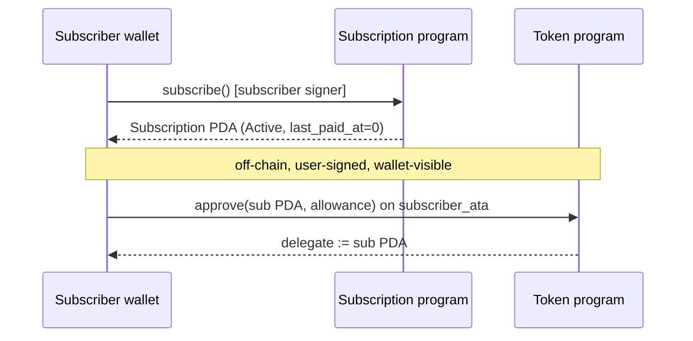
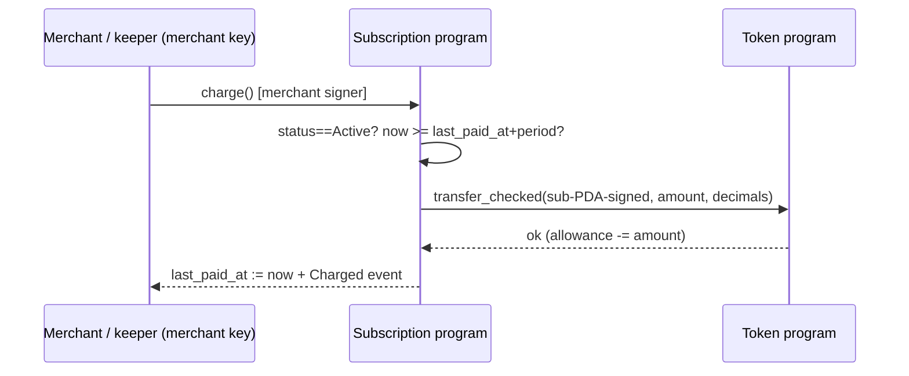

# Subscriptions — Design

On-chain recurring payments, Model B (delegate + `transfer_checked`).
User `approve()`s the Subscription PDA as SPL-Token delegate off-chain;
the program CPIs `transfer_checked` with the Subscription PDA as signer on `charge()`.

Anchor 0.31.1 / `anchor-lang` + `anchor-spl`. Program dir:
`subscriptions/programs/subscriptions/src/`
(`lib.rs`, `state.rs`, `errors.rs`, `events.rs`,
`instructions/{create_plan,subscribe,charge,cancel}.rs`).

## 1. Goal / non-goals

Goal: merchant defines a fixed-price, fixed-period plan for one SPL mint;
subscriber opts in; merchant (or its keeper) pulls exactly `amount` base units
per period via the pre-approved delegate allowance. No escrow, no vault —
funds stay in the subscriber's ATA until each charge.

Non-goals: variable pricing, multi-mint plans, proration/refunds, on-chain
auto-scheduling (cron must come from an off-chain keeper calling `charge()`),
fiat/stable accounting, upgradeable plan terms (amount/period immutable after
`create_plan`; merchant creates a new `plan_id` instead).

## 2. Actors

| Actor | Key | Role |
|---|---|---|
| Merchant | `merchant: Signer` | creates plans, calls `charge()` (directly or via keeper holding its key) |
| Subscriber | `subscriber: Signer` | subscribes, `approve()`s delegate off-chain, calls `cancel()` |
| Keeper/bot | holds merchant key or is delegated by merchant off-chain | permissioned caller of `charge()` only insofar as it holds the merchant key; no separate on-chain role |
| Token program | SPL Token / Token-2022 (pinned to one per deployment) | enforces allowance + decimals on `transfer_checked` / `approve` / `revoke` |

Trust summary: subscriber trusts the program to move at most `amount` per
`period_seconds` while Active; merchant trusts the delegate allowance to still
exist at charge time (subscriber can revoke anytime — that is the cancel
mechanism, not a bug). Nobody trusts the keeper beyond the merchant key.

## 3. PDA layout + seeds

```
Plan PDA:         seeds = [b"plan", merchant_pubkey, plan_id.to_le_bytes()]
Subscription PDA: seeds = [b"sub",  plan_pubkey,     subscriber_pubkey]
```

`plan_id` is `u64`, serialized **little-endian, always 8 bytes**
(`plan_id.to_le_bytes()`), chosen by the merchant (monotonic counter
recommended, uniqueness enforced by PDA collision = re-init fails).

State (exact shapes, `InitSpace` derived):

```rust
// state.rs
pub struct SubscriptionPlan {
    pub merchant: Pubkey,       // plan creator, charge authority
    pub mint: Pubkey,           // SPL mint, immutable
    pub amount: u64,            // base units per period, immutable, > 0
    pub period_seconds: i64,    // > 0, immutable
    pub plan_id: u64,           // merchant-chosen id, part of seeds
    pub bump: u8,               // PDA bump
}

pub struct Subscription {
    pub plan: Pubkey,           // Plan PDA this sub belongs to
    pub subscriber: Pubkey,     // payer, cancel authority
    pub last_paid_at: i64,      // unix ts of last successful charge; 0 = never charged
    pub status: SubscriptionStatus, // Active | Cancelled
    pub bump: u8,               // PDA bump
}

pub enum SubscriptionStatus { Active, Cancelled }
```

Delegate authority is **always the Subscription PDA** (`b"sub"` above).
Nothing else (merchant, keeper, program id) is ever approved.

Space: 8 (discriminator) + struct size via `InitSpace`; `bump` stored so
charge-time `seeds + bump` signing needs no re-derivation.

## 4. State machine

```
         subscribe()                 charge() ok              cancel()
  [none] ───────────► Active ─────────────────────► Active ───────────► Cancelled
                          │                             ▲
                          └──── charge() fails ─────────┘ (state unchanged)
```

- `Active`: chargeable once per period. Terminal exit only via `cancel()`.
- `Cancelled`: terminal. `charge()` rejects (`SubscriptionCancelled`).
  Re-subscribing after cancel creates a **new** Subscription PDA only if the
  old account is closed/re-initialized — v1 does NOT support reactivation;
  subscriber must be issued a fresh subscription (or merchant a new plan).
  `cancel()` on a `Cancelled` subscription is idempotent-reject
  (`AlreadyCancelled`) to keep intent explicit.

`last_paid_at` transitions: `0` at `subscribe()` → `now` on every successful
`charge()`. Never written by any other instruction.

## 5. Instruction specs

### 5.1 `create_plan(plan_id: u64, amount: u64, period_seconds: i64)`

| Account | Mut | Signer | Constraint |
|---|---|---|---|
| `merchant` | — | yes | payer, stored as `plan.merchant` |
| `plan` (PDA) | init | — | `seeds=[b"plan", merchant, plan_id.le]`; `payer=merchant`, `space=8+Plan::INIT_SPACE` |
| `mint` | — | — | any SPL mint; `plan.mint = mint.key()` |
| `system_program` | — | — | |

Auth: any signer may create plans for themselves (merchant = signer).
Validation: `amount > 0` else `InvalidAmount`; `period_seconds > 0` else
`InvalidPeriod`. Stores `bump` from `ctx.bumps`.
CPI: none. Event: `PlanCreated { plan, merchant, mint, amount,
period_seconds, plan_id }`.

### 5.2 `subscribe()`

| Account | Mut | Signer | Constraint |
|---|---|---|---|
| `subscriber` | — | yes | payer, stored as `subscription.subscriber` |
| `plan` (PDA) | — | — | `seeds=[b"plan", plan.merchant, plan.plan_id.le]`, must exist |
| `subscription` (PDA) | init | — | `seeds=[b"sub", plan.key(), subscriber]`; `payer=subscriber` |
| `system_program` | — | — | |

Writes: `plan=plan.key()`, `subscriber`, `last_paid_at=0`,
`status=Active`, `bump`. No token accounts touched on-chain.
Event: `Subscribed { subscription, plan, subscriber }`.

**Off-chain step (REQUIRED, part of subscribe flow):** after (or before) the
tx confirms, the subscriber's wallet issues SPL `approve(subscription_pda,
allowance)` on their ATA for `plan.mint`. Two supported patterns:

- (a) Per-period: `allowance = plan.amount`. Subscriber re-approves before
  every charge. Least trust, worst UX.
- (b) Standing: `allowance = N * plan.amount` (up to `u64::MAX`).
  Program still enforces ≤ `amount` per period (see invariants); subscriber
  must `revoke()` on cancel and audit allowance in wallet/explorer.

The program never CPIs `approve` — the delegate grant must be a direct
user-signed Token-program instruction so wallets display it verbatim.

### 5.3 `charge()`

| Account | Mut | Signer | Constraint |
|---|---|---|---|
| `merchant` | — | yes | `== plan.merchant` else `UnauthorizedMerchant` |
| `plan` (PDA) | — | — | `seeds` as above |
| `subscription` (PDA) | mut | — | `seeds=[b"sub", plan.key(), subscription.subscriber]`; `subscription.plan == plan.key()` else `PlanMismatch`; `status == Active` |
| `subscriber_ata` | mut | — | `mint == plan.mint`, `owner == subscription.subscriber`; `delegate == Some(subscription.key())` checked implicitly by Token program on transfer (explicit `has_one`-style check recommended for a clean error) |
| `merchant_ata` | mut | — | `mint == plan.mint`, `owner == plan.merchant` |
| `mint` | — | — | `== plan.mint`; decimals fed to `transfer_checked` |
| `token_program` | — | — | |
| `clock` | — | — | `Sysvar` |

Logic:

```
now = Clock::get()?.unix_timestamp
due = subscription.last_paid_at.checked_add(plan.period_seconds)
        .ok_or(Overflow)?          // i64 overflow → hard error
require!(subscription.status == Active, SubscriptionCancelled)
require!(now >= due, TooEarly)     // due = period after epoch on first charge
// ^ with last_paid_at == 0, due == period_seconds (≈ epoch + period),
//   i.e. first charge is immediately due. Intentional.
transfer_checked(
  from=subscriber_ata, to=merchant_ata, mint, authority=subscription PDA,
  amount=plan.amount, decimals=mint.decimals,
  signer_seeds=[b"sub", plan.key(), subscriber, bump])?
subscription.last_paid_at = now
```

CPI: exactly one `transfer_checked`, signed by the Subscription PDA.
The Token program enforces allowance (`delegated_amount ≥ amount`) and
decimals; insufficient allowance / wrong delegate surfaces as a Token-program
error, not a program error (documented, not wrapped).
Event: `Charged { subscription, plan, subscriber, merchant, amount, paid_at:
now }`.

Auth: **merchant only**. Keeper bots call with the merchant key; there is no
permissionless-crank mode in v1 (see THREAT.md §5).

### 5.4 `cancel()`

| Account | Mut | Signer | Constraint |
|---|---|---|---|
| `subscriber` | — | yes | `== subscription.subscriber` else `UnauthorizedSubscriber` |
| `subscription` (PDA) | mut | — | `seeds=[b"sub", plan.key(), subscriber]`; `status == Active` else `AlreadyCancelled` |
| `subscriber_ata` | mut | — | `mint == plan.mint`, `owner == subscriber` (for revoke CPI) |
| `token_program` | — | — | |

Logic:

```
require!(status == Active, AlreadyCancelled)   // or NotActive
status = Cancelled
// best-effort revoke of the Subscription-PDA delegate:
revoke(subscriber_ata, owner=subscriber authority)?   // owner = tx signer,
                                                      // NOT the PDA
```

CPI: one `revoke`, authority = **subscriber (tx signer)**. The PDA-as-delegate
cannot revoke itself — SPL `revoke` requires the token-account owner's
signature, which the program holds only because the subscriber signed
`cancel()`. Anchor passes the signer through to the CPI.

Revocation semantics: `revoke` on an ATA with no delegate is a no-op success,
so the CPI is unconditional in the happy path. If the ATA is already closed
or its mint/owner constraints fail, `cancel()` still MUST flip state to
`Cancelled` first (state write before CPI) or document that the caller falls
back to wallet-side `revoke()` + retry — v1 does state-write-first, so the
subscription can never be stuck Active. Either way the subscriber MUST verify
off-chain (wallet/explorer) that `delegate == None` afterwards.
Event: `Cancelled { subscription, plan, subscriber }`.

## 6. Sequence diagrams

### Subscribe (with off-chain approve)



### Charge (gated on Clock)



Failed gates (`Cancelled`, `TooEarly`, allowance short) abort before any CPI;
state is untouched.

### Cancel (+ revoke)

```mermaid
sequenceDiagram
    participant S as Subscriber wallet
    participant P as Subscription program
    participant T as Token program
    S->>P: cancel() [subscriber signer]
    P->>P: status := Cancelled (first)
    P->>T: revoke(subscriber_ata, owner=subscriber)
    T-->>S: delegate := None
    Note over S: verify delegate==None off-chain;<br/>wallet revoke() is the fallback
```

## 7. Error catalog (`errors.rs`)

| Code | Name | Thrown when |
|---|---|---|
| — | `InvalidAmount` | `create_plan` with `amount == 0` |
| — | `InvalidPeriod` | `create_plan` with `period_seconds <= 0` |
| — | `SubscriptionCancelled` | `charge()` on `Cancelled` |
| — | `AlreadyCancelled` | `cancel()` on `Cancelled` (or double-cancel) |
| — | `TooEarly` | `now < last_paid_at + period` |
| — | `UnauthorizedMerchant` | `charge()` signer ≠ `plan.merchant` |
| — | `UnauthorizedSubscriber` | `cancel()` signer ≠ `subscription.subscriber` |
| — | `PlanMismatch` | `subscription.plan ≠ plan.key()` |
| — | `Overflow` | `last_paid_at + period_seconds` overflows `i64` |
| (token) | — | insufficient allowance / wrong delegate / wrong mint / frozen account: surfaced unwrapped from the Token program |

Anchor account-constraint violations (wrong PDA seeds, mint/owner mismatch on
ATAs) fail before handler logic with Anchor's own codes — intentional, keeps
`errors.rs` to business-logic errors only.

## 8. Clock / period edge cases

- **`period_seconds <= 0` rejected** at `create_plan` (`InvalidPeriod`).
  `period == 0` would make every charge trivially due (`now >= last_paid_at`)
  → infinite drain of the allowance in one slot. Never representable.
- **First charge (`last_paid_at == 0`).** `due = 0 + period` = epoch +
  period (1970), so any real `now` passes. First charge is due immediately
  after subscribe+approve — the subscriber pays for the upcoming period.
  (Alternative `last_paid_at = now` at subscribe would grant a free first
  period; explicitly NOT chosen.)
- **`i64` overflow.** `last_paid_at + period` uses `checked_add`; overflow →
  `Overflow` error, charge blocked, funds safe (fail-closed). Realistic
  overflow requires `last_paid_at` near `i64::MAX`, i.e. only via Clock
  corruption — still handled.
- **Clock going backwards / slots vs timestamps.** Solana `unix_timestamp`
  is validator-reported; small jitter/back-step is possible. Effect is bounded:
  a charge may become due one slot earlier/later; double-charge within a period
  is still impossible because `last_paid_at` is set to the `now` observed at
  charge time and the next `due` is strictly after it (`period > 0`).
  No slot-based logic is used anywhere.
- **Skipped periods.** If the keeper misses periods, `charge()` collects only
  ONE period's `amount` and resets the clock to `now` (no back-billing).
  Catch-up billing is explicitly out of scope.
- **Same-slot double `charge()`.** Second call sees updated `last_paid_at`
  (or fails `TooEarly`); allowance debit is atomic per tx. No reentrancy:
  single CPI, no cross-program reentry into the program.

## 9. Token decimals handling

- `amount` is denominated in **base units** (lamport-equivalents) of `plan.mint`.
  UI must convert using `mint.decimals` (e.g. 6-decimal USDC: 5.00 USDC = `5_000_000`).
- `charge()` reads `decimals` from the on-chain `mint` account and passes it
  to `transfer_checked`; a wrong-decimals caller cannot slip through — the
  Token program rejects mismatched decimals.
- Plan is bound to exactly one mint forever (`plan.mint` immutable);
  subscriber/merchant ATAs must both have `mint == plan.mint` (Anchor
  `token::mint` constraints + Token-program check).
- Token-2022 transfer-fee / confidential-transfer extensions: v1 targets the
  classic SPL Token program interface via `anchor-spl::token`; Token-2022
  mints with transfer fees will move `amount` pre-fee semantics — merchant
  MUST validate mint extensions before creating a plan. Documented, not coded.

## 10. Verifiable invoices (winner-slice: batch billing + receipt)

Why: pure subscription rails are a crowded, no-win cluster (Colosseum
Copilot: `stablecoin-rails` winners are all narrow verticals — batch
invoicing, POS, SME reporting). Invoices add the CargoBill/MainDocs twist
on top of the unchanged delegate trust model: no vault, no custody.

### 10.1 Invoice PDA + seeds

```
Invoice PDA: seeds = [b"invoice", subscription_pubkey, invoice_id.to_le_bytes()]
```

```rust
// state.rs
pub struct Invoice {
    pub plan: Pubkey,          // plan whose amount is snapshotted
    pub subscription: Pubkey,  // billed subscription (delegate holder)
    pub merchant: Pubkey,      // create/charge/void authority
    pub subscriber: Pubkey,    // payer (copied from subscription)
    pub invoice_id: u64,       // merchant-chosen per subscription
    pub amount: u64,           // == plan.amount at creation (immutable)
    pub memo_hash: [u8; 32],   // sha256 over OFF-CHAIN metadata
    pub paid_at: i64,          // 0 = unpaid
    pub status: InvoiceStatus, // Unpaid | Paid | Voided
    pub bump: u8,
}
```

`memo_hash` pins buyer / BoL / line-items / dates that live off-chain (or in
the Blink URL). Paid invoice + metadata whose sha256 matches = verifiable
receipt (`GET /api/actions/report?invoice=<pda>` returns the JSON receipt).

### 10.2 Instructions

| Ix | Authority | Gates | Effect |
|---|---|---|---|
| `create_invoice(invoice_id, memo_hash)` | merchant (`== plan.merchant`) | subscription `Active` | init Unpaid invoice, amount = plan.amount |
| `charge_invoice()` | merchant | subscription `Active`, invoice `Unpaid` + bound, `now >= last_paid_at + period`, delegate allowance ≥ amount | `transfer_checked(plan.amount)` via sub-PDA signer; invoice `Paid`, `paid_at = now`, `subscription.last_paid_at = now`; emits `InvoiceCharged` (receipt) |
| `void_invoice()` | merchant (`== invoice.merchant`) | invoice `Unpaid` | invoice `Voided`. Paid invoices are immutable |

Batch = N `charge_invoice` instructions in ONE transaction, signed once by
the merchant (`POST /api/actions/batch`, cap 8). One period per charge still
applies per subscription (clock gate unchanged) — a batch across distinct
subscriptions settles immediately; a second invoice on the same subscription
fails `TooEarlyToCharge` until the next period, exactly like `charge()`.

### 10.3 Invariants (extend §5)

- Invoice amount can never differ from the plan: snapshot + equality check
  (`InvalidAmount` otherwise). Variable pricing stays a non-goal.
- Double-billing one invoice is impossible: `Paid`/`Voided` reject with
  `AlreadyPaid`.
- Cross-subscription confusion is impossible: `invoice.subscription` binding
  checked (`InvoiceMismatch`).
- Void never touches funds; cancel semantics (§5.4) unchanged.

## 11. Collection fee (40 bps)

Every `charge()` and `charge_invoice()` splits the plan amount on-chain:
`(amount − fee)` → merchant ATA, `fee` → treasury ATA. Constants live in
`programs/subscriptions/src/fees.rs`: `FEE_BPS = 40`,
`FEE_DENOMINATOR = 10_000`, `TREASURY_WALLET =
2p1sPBmViJjKhUM1aKCsd25nayKeXRJnpmJAWwfYbucP`.

```
fee            = floor(amount * 40 / 10_000)   // u128 math, rounds down, min 0
merchant_share = amount - fee                   // >= 1 always (40 < 10_000)
```

| amount (base units) | fee | merchant share |
|---|---|---|
| 249 | 0 (dust: full amount to merchant) | 249 |
| 250 | 1 | 249 |
| 1_000_000 (1.00 at 6 decimals) | 4_000 | 996_000 |

### 11.1 Why 0.4%, not 0.1%

- **0.1% floors to zero exactly where micro-subscriptions live.** At 10 bps,
  any `amount < 1000` base units pays no fee at all (< 0.001 token at 6
  decimals) — the fee would be unenforceable on small plans and trivially
  gameable by splitting plans. At 40 bps the zero-fee band shrinks to
  `amount < 25`, i.e. sub-cent dust no honest plan prices at.
- **Stripe-order, one rung down.** Card rails take ~2.9% + 30¢; 0.4% is an
  order of magnitude cheaper (the crypto-rail pitch) while staying a real
  revenue line — unlike 0.1%, which is below per-charge noise.
- **Measurable at batch scale.** One `charge_invoice` carries a 4-unit fee
  per 1.00 token; an 8-invoice batch settles 8 × fee in a single merchant
  signature — treasury inflow is observable per tx, not just in aggregate.

### 11.2 Mechanics

- **Two CPIs, one signer.** Both legs are `transfer_checked` signed by the
  Subscription PDA (same delegate, same allowance). The fee leg is skipped
  when `fee == 0` (dust path — no zero-amount CPI). Legs sum to `amount`,
  so the existing allowance gate (`delegated_amount >= plan.amount`) covers
  the split exactly; subscribers approve exactly as before.
- **Treasury binding (no input trust).** `treasury: SystemAccount` is pinned
  by `#[account(address = TREASURY_WALLET)]` — callers cannot redirect it.
  `treasury_ata` is `init_if_needed` (`payer = merchant`,
  `authority = treasury`, per mint), so ATA derivation double-binds
  (mint, owner). The treasury never pays: ATA rent comes from the merchant,
  who is the fee payer of the whole charge anyway.
- **Merchant == treasury edge.** If a plan's merchant IS the admin wallet,
  both legs land in the same ATA; total credited still equals `amount`.
- **Events (append-only).** `Charged` gains `fee` after `amount`;
  `InvoiceCharged` gains trailing `fee` after `paid_at`. No existing field
  is renamed, removed, or reordered — old readers ignore the new tail.
- **No state change.** Fee adds no stored fields (no migration, no extra
  rent on Plan/Subscription/Invoice accounts). Rent impact is one ATA per
  mint, funded by the first charging merchant.

### 11.3 Backward compatibility

- Off-chain `approve(amount)` flows are unchanged (allowance covers the
  split by construction).
- Tx builders must pass the two new accounts (`treasury`, `treasuryAta`);
  `actions/src/solana.ts` defaults `treasuryAta` to the derived address, so
  charge/batch routes build valid txs without changes.
- Indexers: `amount` still means gross per-period debit; `fee` is the
  treasury cut. `merchant_share = amount − fee` — never re-derive from
  balance deltas (dust rounding lives on-chain).
